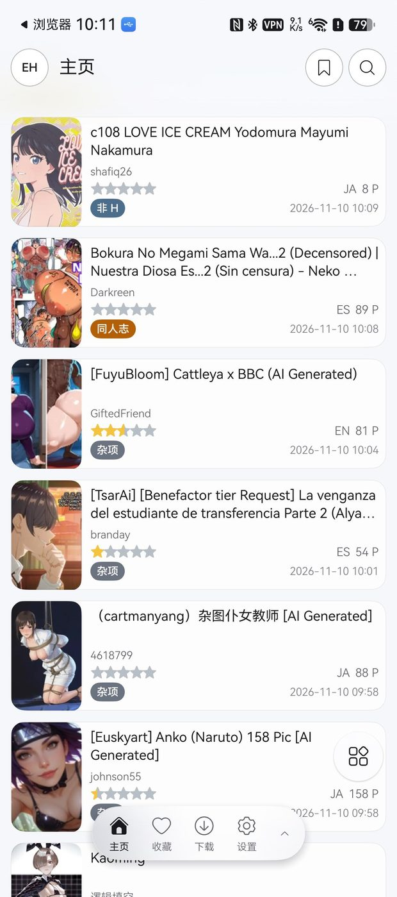
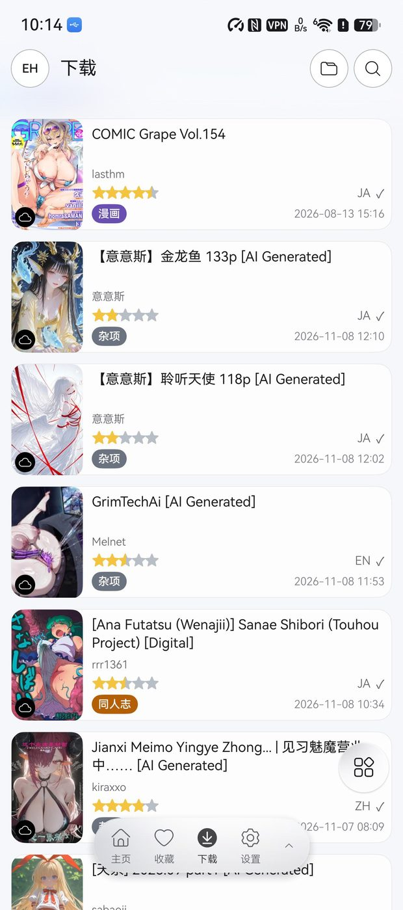

<h1 align="center">EhViewer HM</h1>

Native E-Hentai client for HarmonyOS NEXT · Rewritten in ArkTS / ArkUI
 

---

EhViewer HM is a native HarmonyOS rewrite of the Android EhViewer — not a wrapper port. The entire UI and logic are reimplemented in ArkTS / ArkUI, with a single adaptive codebase for phones, foldables, tablets and PC free-form windows.

  
  
  
  

## Highlights

**Works on constrained networks**
- Built-in Hosts + DNS-over-HTTPS + domain fronting combo keeps direct connections alive even on routes that block by SNI
- Automatic fallback probing on direct-connection failure; when a VPN is active the app steps aside and hands domain-resolution to the VPN — no conflicts
- Built-in network diagnostics panel for the main site / EX / Forums / update sources

**Full feature coverage**
- Browse & search: front page, watched, popular, rankings, cloud & local favorites, history; combined keyword / multi-tag / uploader / category / rating / page-range search; cover and similar-gallery search
- Details & interaction: favorite folders, rating, comments, previews, torrents, tag subscription / blocking / voting
- Downloads: multi-threaded, slow-node auto-skip, resume, retry, batch management, dual locations, ZIP import/export
- Reader: paged & continuous modes, dual-page spread with adaptive splitting, orientation handling, pinch zoom, white-border cropping, progress memory, volume-key paging

**Reading experience**
- 11 color & tone adjustments (brightness / contrast / clarity / sharpen / highlights / shadows / etc.)
- Core Vision super-resolution, SDR to HDR
- In-comic text translation: built-in OCR + web translation / DeepSeek / OpenAI / Gemini / custom endpoints
- 44k+ Chinese tag translation library with online updates

**Your data, your control**
- Itemized migration from the Android version: history, favorites, download queue, local galleries, tags, filters, search history
- Copy the download directory over and hit "restore downloads" — finished galleries are registered in place
- JSON backup / Wi-Fi direct transfer / WebDAV & NAS sync
- One-tap restore default settings (double-tap confirm; cookies, downloads and history are never touched)

**Security & privacy**
- App lock, pattern protection, privacy mode (blocks screenshots & recording)
- Fully localized Chinese UI

## Install

Download `EhViewer_HM_0.1.0.hap` from [Releases](../../releases).

HarmonyOS ships no HAP installer; use [auto-installer](https://github.com/likuai2010/auto-installer) or `hdc install`.

## Build

1. Open the project in DevEco Studio
2. Configure local signing per `build-profile.json5.example`
3. Build with `hvigorw assembleHap` or from the IDE

## Disclaimer

This app is a client only; it provides and hosts no content. Use it in compliance with your local laws and the target site's terms of service.

## License

[GPL-3.0](LICENSE)
